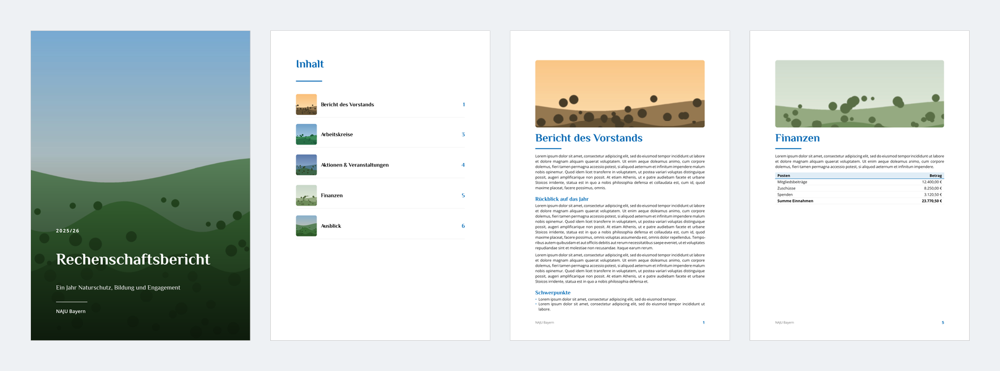

# Rechenschaft

Ein [Typst](https://typst.app)-Template für Rechenschafts- und Jahresberichte von Vereinen und Jugendgruppen – mit Titelseite im Vollbild, bebildertem Inhaltsverzeichnis und Kapiteln mit Bildbanner.



## Schnellstart

```sh
typst compile --font-path fonts main.typ
```

`--font-path fonts` sorgt dafür, dass die mitgelieferten Schriften (Open Sans, Philosopher) verwendet werden. Beim Arbeiten lohnt sich `typst watch` statt `typst compile`.

## Verwendung

```typ
#import "naju-bericht.typ": bericht, kapitel

#show: bericht.with(
  titel: "Rechenschaftsbericht",
  untertitel: "Ein Jahr Naturschutz, Bildung und Engagement",
  zeitraum: "2025/26",
  organisation: "NAJU Bayern",
  titelbild: image("bilder/titel.jpg"),
)

#kapitel("Bericht des Vorstands", bild: image("bilder/kapitel-vorstand.jpg"))

== Rückblick auf das Jahr

Hier steht der Text …
```

Ein vollständiges Beispiel steht in [main.typ](main.typ).

### `bericht` – Optionen

| Option               | Standard                   | Beschreibung                                  |
| -------------------- | -------------------------- | --------------------------------------------- |
| `titel`              | `"Rechenschaftsbericht"`   | Titel auf der Titelseite und in der Kopfzeile |
| `untertitel`         | `none`                     | Untertitel auf der Titelseite                 |
| `zeitraum`           | `none`                     | z. B. `"2025/26"`                             |
| `organisation`       | `"NAJU Bayern"`            | Name in Fußzeile und auf der Titelseite       |
| `titelbild`          | `none`                     | Hintergrundbild der Titelseite                |
| `logo`               | `none`                     | Logo oben rechts auf der Titelseite           |
| `farbe`              | `rgb("#0069b4")`           | Akzentfarbe für Überschriften, Linien, Tabellen |
| `schrift`            | `("Open Sans", …)`         | Schrift für den Fließtext                     |
| `schrift-titel`      | `("Philosopher", …)`       | Schrift für Überschriften und Titel           |
| `inhaltsverzeichnis` | `true`                     | Inhaltsverzeichnis ein- oder ausblenden       |

### `kapitel` – neues Kapitel

```typ
#kapitel("Titel", bild: image("..."), banner: true)
```

Beginnt eine neue Seite und setzt eine Überschrift erster Ebene. Mit `bild` erscheint oben ein Bildbanner und das Bild als Vorschau im Inhaltsverzeichnis. Mit `banner: false` wird das Bild nur im Inhaltsverzeichnis gezeigt.

Für Unterabschnitte reichen normale Typst-Überschriften (`==`, `===`). Listen, Tabellen und Bildunterschriften werden automatisch in der Akzentfarbe gestaltet.

## Projektstruktur

```
naju-bericht.typ   Das Template
main.typ           Beispielbericht
bilder/            Titel- und Kapitelbilder
fonts/             Open Sans und Philosopher (SIL Open Font License)
vorschau/          Vorschaubild für diese README
```
